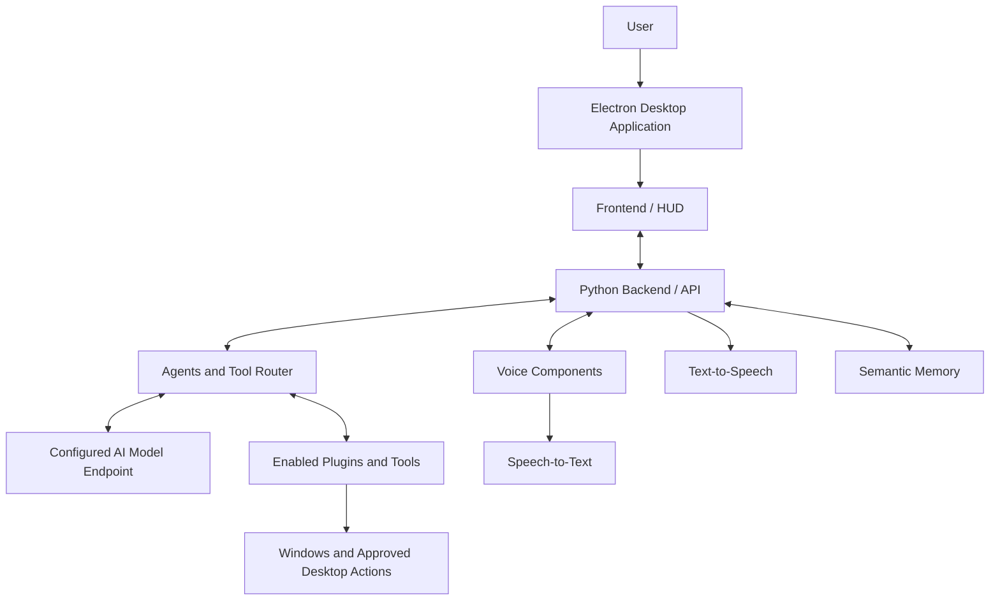
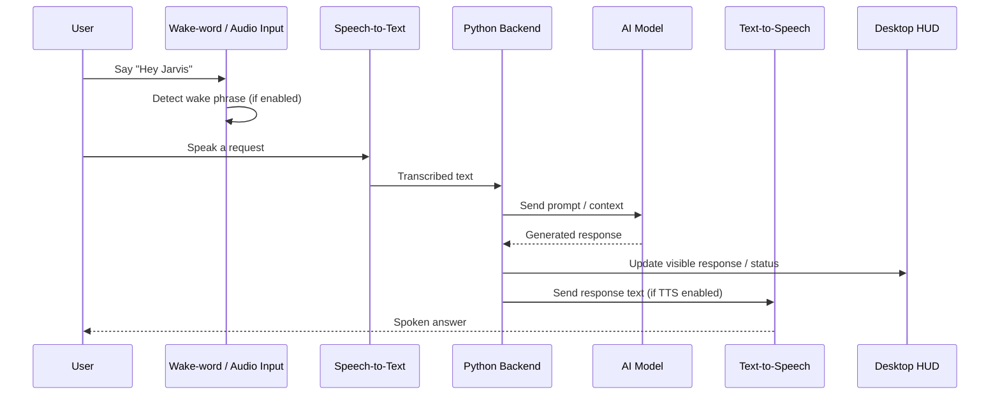
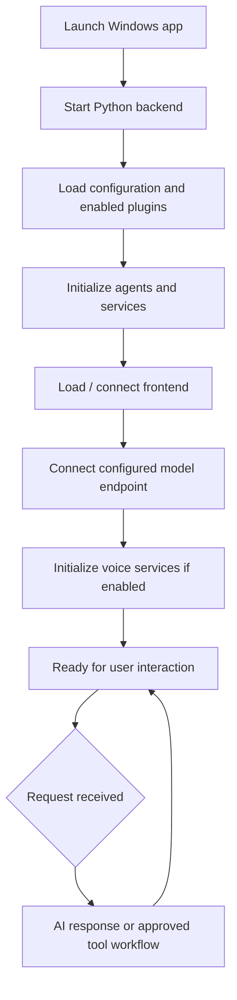

::: {align="center"}
# J.A.R.V.I.S.

### Personal AI Desktop Assistant for Windows

**A futuristic desktop HUD with voice interaction, AI-model
connectivity, modular tools, and a Python-powered backend.**

```{=html}
<p>
```
``{=html}
```{=html}
</p>
```
```{=html}
<p>
```
``{=html}
``{=html}
``{=html}
``{=html}
``{=html}
```{=html}
</p>
```
[Overview](#overview) · [Screenshots](#screenshots) ·
[Architecture](#architecture) · [Setup](#setup-on-windows) ·
[Troubleshooting](#troubleshooting) · [Roadmap](#roadmap)
:::

------------------------------------------------------------------------

## Overview

**JARVIS** is a personal AI desktop-assistant project for Windows, built
around a futuristic heads-up display (HUD), a Python backend, an
Electron desktop shell, voice-related components, and a modular system
of AI agents and tools.

The screenshots show a dark, high-contrast interface with a central
animated-style JARVIS visual, system diagnostics, subsystem status, a
mission log, terminal panels, voice controls, and settings. Development
has also included integration with an OpenAI-compatible model endpoint,
speech processing, semantic memory, and a media-generation plugin.

The goal is to make desktop AI interaction more natural and extensible:
ask questions, speak to the assistant, use supported tools, and add
capabilities through modular components.

> **Project status:** This repository is under active development. The
> screenshots demonstrate the interface and visible application state,
> not proof that every displayed subsystem or planned workflow is fully
> functional. See [Current status and
> limitations](#current-status-and-limitations).

## At a glance

  -----------------------------------------------------------------------
  Area                                What is present in the development
                                      evidence
  ----------------------------------- -----------------------------------
  Desktop UI                          Electron-based JARVIS interface
                                      with a futuristic HUD

  Backend                             Python application backend

  Model connection                    OpenAI-compatible API
                                      configuration; latest recorded
                                      model setting was
                                      `gemma4:31b-cloud`

  Voice                               Microphone controls and
                                      speech-related components in
                                      startup/debug logs

  Agents and plugins                  Latest recorded startup check
                                      reported 9 agents, 14 plugins, and
                                      82 tools

  Memory                              Semantic-memory component;
                                      `data/memory.db` appeared in the
                                      recorded configuration

  Image generation                    `media_generation` plugin and
                                      `flux2-klein` selection visible in
                                      the UI; end-to-end workflow needs
                                      verification

  Mobile companion                    A future direction, not confirmed
                                      as implemented
  -----------------------------------------------------------------------

Counts and configuration values above reflect development
logs/screenshots shared during development. They may change between
versions.

## Screenshots

### Main dashboard

The dashboard brings system diagnostics, uptime, mission activity,
subsystem information, tool activity, and the central JARVIS visual into
one interface.

```{=html}
<p align="center">
```
``{=html}
```{=html}
</p>
```
### Dashboard and status panels

```{=html}
<p align="center">
```
``{=html}
```{=html}
</p>
```
The header displays the configured model/provider and counts for tools
and plugins. The surrounding panels present system metrics and
application status.

### Input and response terminals

```{=html}
<p align="center">
```
``{=html}
```{=html}
</p>
```
The terminal-style panels provide a place for typed prompts and
assistant responses. The example shows a response in the JARVIS output
area.

### Voice input controls

```{=html}
<p align="center">
```
``{=html}
```{=html}
</p>
```
The interface includes microphone and audio controls alongside a
text-entry fallback. Voice activation, speech accuracy, and spoken
response behavior should be validated on the target machine.

### Startup screen

```{=html}
<p align="center">
```
``{=html}
```{=html}
</p>
```
The startup screen indicates that speech and AI models are loading.
Actual startup time depends on model configuration and available
hardware.

### Settings and voice options

```{=html}
<p align="center">
```
``{=html}
```{=html}
</p>
```
The visible settings include options for spoken responses, listening for
a wake word, stopping speech with a spoken command, resetting panel
layout, and viewing model/tool configuration.

### Speech-recognition diagnostics

```{=html}
<p align="center">
```
``{=html}
```{=html}
</p>
```
The diagnostic panel is useful during development. The screenshot
includes empty and discarded transcript events, so recognition quality
and wake/voice handling remain important areas for testing.

### Alternate dashboard view

```{=html}
<p align="center">
```
``{=html}
```{=html}
</p>
```
### Layout reset confirmation

```{=html}
<p align="center">
```
``{=html}
```{=html}
</p>
```
The interface provides a confirmation before resetting panel positions
and sizes.

## Key features

-   **Futuristic HUD:** dark interface, central JARVIS graphic,
    diagnostic panels, mission log, and subsystem indicators.
-   **Electron desktop shell:** desktop-app experience for Windows.
-   **Python backend:** application services and assistant
    orchestration.
-   **Voice interaction components:** microphone input, speech-related
    processing, and TTS integrations have appeared in development logs.
-   **Wake-word goal:** "Hey Jarvis" hands-free activation is a key
    project objective; reliability must be tested.
-   **Configurable model integration:** OpenAI-compatible API
    configuration with an Ollama-compatible endpoint in the recorded
    setup.
-   **Agent-based design:** specialized roles for planning, execution,
    research, coding, files, system tasks, memory, vision, and voice
    were reported in the latest configuration.
-   **Extensible plugins and tools:** modular capabilities for browser,
    code, files, research, memory, system monitoring, voice, vision,
    web, and media generation.
-   **Semantic memory:** a local memory database appeared in the
    recorded configuration.
-   **Image-generation exploration:** a media-generation plugin and a
    FLUX.2-klein model selection are visible in development evidence.
-   **Diagnostics and settings:** visible subsystem metrics, logs, voice
    settings, and panel-layout controls.

Feature availability depends on the current code, configuration,
installed dependencies, permissions, and external services.

## Architecture

The following diagram is a **high-level conceptual view** based on the
available development evidence. Verify actual transport paths and module
boundaries against the source before treating it as an exact
implementation diagram.



### Voice-processing sequence

This represents the intended voice workflow. Each stage should be tested
independently; the screenshots alone do not establish that every stage
is fully reliable.



### Startup and runtime flow



The actual launch order can differ by version. Use the repository's
current startup scripts and logs to confirm the sequence.

## Technology stack

  -----------------------------------------------------------------------------
  Layer                   Technology / component  Notes
  ----------------------- ----------------------- -----------------------------
  Desktop runtime         Electron                Desktop shell reported in
                                                  project context

  Frontend                Built web frontend;     Verify exact framework and
                          React/TypeScript/Vite   scripts in `package.json`
                          intended or reported in 
                          project description     

  Backend                 Python                  Main assistant and API
                                                  services

  Model API               OpenAI-compatible       Latest recorded provider
                          interface               setting: `openai_compatible`

  Model endpoint          Ollama-compatible URL   `http://localhost:11434/v1`
                          in recorded setup       appeared in logs

  Model                   `gemma4:31b-cloud`      Latest recorded model
                                                  setting; earlier development
                                                  also explored Qwen3:8B

  Speech recognition      Whisper /               Check model download and
                          faster-whisper appeared hardware requirements
                          in logs                 

  Text-to-speech          Piper and Edge-TTS      Exact active engine depends
                          appeared in logs        on configuration

  Communication           HTTP and WebSocket      Recorded backend used port
                          endpoints               `7341`

  Memory                  Local database          `data/memory.db` appeared in
                                                  recorded configuration

  Media generation        `media_generation`      `flux2-klein` appeared in UI;
                          plugin                  verify workflow

  Packaging               Electron                Confirm supported commands in
                          build/packaging         the current Electron package
                                                  configuration
  -----------------------------------------------------------------------------

Do not assume the table represents exact installed versions. The package
manifests and configuration files are the source of truth.

## Agents and plugins

The latest recorded backend check reported **9 agents, 14 plugins, and
82 tools**.

### Agent roles reported

  Agent        Intended role
  ------------ ------------------------------------
  `planner`    Break a request into steps
  `executor`   Coordinate approved task execution
  `research`   Research and information gathering
  `code`       Programming assistance
  `file`       File-related workflows
  `system`     Approved system-related tasks
  `memory`     Memory operations
  `vision`     Vision workflows when available
  `voice`      Voice workflows

### Plugin names observed

-   `agent_backend_tools`
-   `archive_research`
-   `browser_tools`
-   `code_tools`
-   `file_tools`
-   `media_generation`
-   `memory_tools`
-   `quote_tools`
-   `search_engine_hub`
-   `shell_tools`
-   `system_monitor`
-   `vision_tools_optional`
-   `voice_tools_optional`
-   `web_tools`

Optional plugins may require additional packages, permissions, provider
setup, or API credentials. The count and names can change as the project
evolves.

## Repository structure

The actual source archive was not attached with this request, so the
tree below is **indicative rather than verified**. Keep the real folder
names from your repository and adjust this section after checking the
project root.

``` text
JARVIS-main/
├── jarvis/                  # Python package, if present
│   ├── main.py              # Backend entry point, if present
│   ├── server/              # API routes and server setup, if present
│   ├── agents/              # Agent implementations, if present
│   ├── plugins/             # Plugin implementations, if present
│   └── ...                  # Other modules
├── web/
│   └── dist/                # Built frontend observed in development
├── electron/                # Electron application files, if present
├── data/
│   └── memory.db            # Local memory DB observed in development
├── docs/
│   └── images/              # README screenshots
├── requirements.txt         # Python dependencies, if present
├── run.bat                  # Launcher, if present
├── run-app.bat              # Desktop launcher, if present
├── run-dev.bat              # Development launcher, if present
├── setup.bat                # Setup helper, if present
└── README.md
```

## Setup on Windows

### Prerequisites

Check the versions supported by the current project before installing:

-   Windows 11 (Windows 10 may also work, depending on dependencies).
-   Python version supported by the repository.
-   Node.js and npm if the Electron frontend requires them.
-   Ollama or the configured model provider, if used.
-   A supported model available at the configured endpoint.
-   Microphone and audio output devices for voice features.
-   Additional disk space, RAM, and GPU capacity for speech/AI models.

### 1. Get the project

Clone the repository, replacing the URL with your actual GitHub
repository URL:

``` powershell
git clone YOUR_REPOSITORY_URL JARVIS-main
cd JARVIS-main
```

If you already have the project locally, open PowerShell in that folder
instead.

### 2. Inspect the project scripts

``` powershell
Get-ChildItem
```

Read `README`, `package.json`, `requirements.txt`, and the configuration
files that actually exist. Do not run setup scripts you have not
reviewed.

### 3. Install Python dependencies

If the project uses `requirements.txt` and a `venv` environment, a
typical setup is:

``` powershell
py -m venv venv
.\venv\Scripts\python.exe -m pip install --upgrade pip
.\venv\Scripts\python.exe -m pip install -r requirements.txt
```

Use the Python version and virtual-environment directory expected by the
repository. If the project already has a supported environment, avoid
creating a conflicting second environment.

### 4. Install desktop dependencies

If the repository has an `electron/package.json` or a root
`package.json`, follow the scripts defined there. For example, when
`electron/package.json` is the relevant manifest:

``` powershell
cd electron
npm install
cd ..
```

This command is conditional: confirm the actual package location before
running it.

### 5. Verify the model endpoint

If using Ollama:

``` powershell
ollama list
```

Check that Ollama is running and the configured model/provider is
available. The latest recorded configuration used
`http://localhost:11434/v1` and `gemma4:31b-cloud`; older development
also explored Qwen3:8B. Use the model name in your current
configuration, not both by assumption.

### 6. Launch JARVIS

Development logs have included `run-app.bat` and `run.bat`. Use only the
launcher that exists and is documented for your current version:

``` powershell
.\run-app.bat
```

Or, if the repository specifies the Python launcher:

``` powershell
.\run.bat
```

Do not launch multiple copies of the backend unless the project
explicitly supports that setup. If startup fails, preserve the first
relevant error and sanitized logs.

### 7. Verify the application

-   The desktop UI loads.
-   The Python backend starts without a fatal error.
-   The configured model endpoint responds.
-   Expected plugins and agents initialize.
-   The microphone receives audio.
-   Speech recognition returns a useful transcript.
-   Spoken output works when enabled.
-   A simple typed prompt returns a valid answer.

The backend port and URLs may differ from the values shown in
development screenshots/logs.

## Configuration

Use the configuration files and environment variables supported by the
actual source. Typical settings may include:

-   AI provider, endpoint, and model name.
-   Backend host and port.
-   WebSocket URL.
-   Audio device, wake-word sensitivity, and speech settings.
-   TTS engine and voice.
-   Enabled/disabled plugins.
-   Media-generation provider and model.
-   Memory database path.

The recorded development UI displayed:

-   Provider: `openai_compatible`
-   Model: `gemma4:31b-cloud`
-   Image model: `flux2-klein`
-   Tools: `82`
-   Plugins: `14`

These are observed UI values, not guaranteed defaults. Confirm the
current `config.yaml` or other supported configuration before changing
settings.

If the project uses a `.env` file, keep it out of Git and provide a safe
`.env.example` with placeholder values only.

## Development commands

The exact commands depend on the scripts in the current repository.
Inspect the relevant `package.json`, `pyproject.toml`,
`requirements.txt`, and batch files before using them.

  -----------------------------------------------------------------------
  Task                                Guidance
  ----------------------------------- -----------------------------------
  Run desktop app                     Use the supported launcher, such as
                                      `run-app.bat`, if present

  Run backend only                    Use the entry point documented by
                                      the current project

  Install Python packages             Use the project's
                                      `requirements.txt` or dependency
                                      manager

  Install frontend packages           Run npm in the directory containing
                                      the correct `package.json`

  Build frontend                      Use the build script defined in
                                      that `package.json`

  Package Windows app                 Use the configured Electron
                                      builder/packager scripts, if
                                      present

  Run tests                           Use the test commands actually
                                      defined by the project
  -----------------------------------------------------------------------

No unverified build command is presented as guaranteed to work.

## Troubleshooting

### Startup stays on "Starting JARVIS"

-   Check the backend logs for model-loading or speech-initialization
    errors.
-   Confirm the model endpoint is reachable.
-   Check whether a speech model is downloading or loading.
-   Wait for the configured initialization timeout, then inspect logs
    rather than repeatedly launching the app.
-   Verify that the frontend can reach the backend.

### "Hey Jarvis" does not activate

-   Check Windows microphone permissions.
-   Confirm the intended input device is selected.
-   Test the microphone independently.
-   Inspect audio-level and wake-word confidence logs.
-   Check for microphone disconnects or unstable input levels.
-   Avoid triggering the detector from JARVIS's own TTS output.
-   Treat wake-word activation as unverified until it works repeatedly
    in real use.

### Speech recognition returns empty or incorrect transcripts

-   Check microphone selection and sample rate.
-   Verify the speech model loaded successfully.
-   Review transcript confidence and discarded-transcript logs.
-   Test in a quiet environment and compare typed prompts against voice
    prompts.
-   Tune thresholds only after inspecting real input data.

The supplied screenshot includes empty and discarded transcript events,
so this is a known area to validate.

### No startup sound or spoken answer

-   Check Windows output device and volume.
-   Test the configured TTS engine independently.
-   Check voice-output settings.
-   Review audio initialization errors.
-   Prevent overlapping speech tasks from interrupting one another.

### Model responses are slow or empty

-   Confirm the configured model name and endpoint.
-   Verify that the provider is available.
-   Inspect timeout, streaming, and response-parsing behavior.
-   Measure model latency separately from speech recognition and TTS.
-   Avoid assuming that a model is local merely because the endpoint is
    compatible with Ollama.

### Frontend or Electron window does not load

-   Check the Electron console and backend logs.
-   Verify the frontend build output exists if the backend serves it.
-   Confirm the configured host and port.
-   Follow the build scripts in the actual package manifest.

## Security and privacy

-   Never commit API keys, passwords, tokens, private logs, or personal
    data.
-   Do not expose the local model endpoint or backend directly to the
    public internet.
-   Validate and authorize tool calls before performing desktop
    operations.
-   Do not allow model output to execute arbitrary shell commands
    without a strict authorization layer.
-   Require confirmation for destructive or externally visible actions.
-   Use least-privilege permissions.
-   Make microphone and background operation visible and controllable.
-   Redact sensitive information from logs.
-   Review all optional plugins before enabling them.

## Build and packaging

A Windows executable or installer may be possible if the existing
Electron project includes and configures a packaging tool. **Packaging
support has not been verified from the source files in this request.**

Before publishing a build:

1.  Inspect Electron's `package.json` and packaging configuration.
2.  Confirm frontend build scripts.
3.  Confirm how the Python backend and its dependencies are bundled or
    installed.
4.  Decide how speech models and other large assets will be delivered.
5.  Test on a clean Windows environment.
6.  Document antivirus prompts, permissions, model setup, and first-run
    behavior.
7.  Never bundle API secrets in the executable.

## Current status and limitations

### Evidenced by the supplied screenshots or recorded development logs

-   Futuristic dark JARVIS HUD and dashboard panels.
-   Input and output terminal panels.
-   Voice input controls and settings.
-   Startup screen indicating speech and AI model initialization.
-   Speech-recognition diagnostic panel.
-   Model/provider and tool/plugin indicators.
-   A reset-layout confirmation dialog.
-   Recorded backend initialization with 9 agents, 14 plugins, and 82
    tools.

### Needs end-to-end verification

-   Reliable "Hey Jarvis" wake-word activation.
-   Consistent speech-to-text transcription.
-   Stable spoken responses without unwanted interruption.
-   Actual system-control actions and their authorization.
-   Complete image-generation request-to-result workflow.
-   Windows executable/installer packaging.
-   Secure mobile connectivity.

### Not claimed as complete

-   Full control of every Windows or Android feature.
-   Production-grade phone OTP authentication and pairing.
-   Fully tested remote access from anywhere.
-   Production-ready image/video generation.
-   Guaranteed response speed or accuracy.

## Roadmap

-   [x] Build a distinctive JARVIS-style desktop HUD and dashboard.
-   [x] Add visible input/output and system-diagnostics panels.
-   [x] Add settings for voice and panel layout.
-   [x] Establish a modular agent/plugin architecture in the recorded
    configuration.
-   [ ] Improve wake-word reliability and hands-free operation.
-   [ ] Improve speech-recognition quality and false-transcript
    handling.
-   [ ] Improve startup audio, TTS interruption, and latency.
-   [ ] Validate image generation end to end.
-   [ ] Add automated tests for core voice, model, and tool workflows.
-   [ ] Verify Windows packaging and clean-machine installation.
-   [ ] Develop a secure Android companion with verified authentication
    and explicit device pairing.

Checkboxes should be updated as work is actually completed and tested.

## Contributing

Contributions and suggestions are welcome.

1.  Open an issue with a clear description and reproduction steps.
2.  Share sanitized logs only.
3.  Make changes on a separate branch.
4.  Run relevant tests.
5.  Submit a pull request explaining what changed and how it was
    verified.

Do not upload virtual environments, model weights, credentials, personal
data, or unnecessary runtime logs.

## License

No license is specified here. Add a `LICENSE` file only after choosing
the license you intend to use. Until then, do not assume others have
permission to reuse, modify, or distribute this project.

## Acknowledgements

JARVIS builds on the broader Python, Electron, AI-model, and
speech-processing ecosystem. Add precise credits and links for the
libraries, models, and services actually used by the repository before
publishing a final release. Follow the relevant model and package
licenses.

------------------------------------------------------------------------

::: {align="center"}
**JARVIS --- an evolving personal AI desktop assistant.**

*Built iteratively with a focus on voice-first interaction, modular AI
capabilities, and a distinctive desktop experience.*
:::
